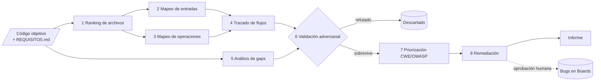

# Metodología SAST descompuesta — guía detallada

Esta guía explica, paso a paso, cómo funciona la metodología SAST del Grupo 7:

- qué archivos recibe cada paso
- qué hace y cómo valida lo que produce
- qué archivos genera y qué significa cada campo
- un ejemplo real de cada parte

Todos los ejemplos salen de la ejecución de referencia sobre la app vulnerable de muestra,
en `agente-sast-g7/samples/app-vulnerable/esperado/`.

> **Siempre sobre código con vulnerabilidades.** El concurso valida la ejecución real.
> Usa la muestra `agente-sast-g7/samples/app-vulnerable/` (por defecto) o un proyecto real
> clonado en `objetivos/<proyecto>/`. Cómo invocar cada cosa desde Copilot: `COPILOT.md`.

## 1. Visión general

En lugar de pedir a un solo agente "encuentra vulnerabilidades", el trabajo se divide en
**8 pasos de una sola responsabilidad**. Cada uno deja un JSON que lee el siguiente. Antes
de priorizar, un validador adversarial intenta refutar cada hallazgo.



| # | Paso | Agente | Corre solo | Necesita | Genera | Tipo |
|---|---|---|---|---|---|---|
| 1 | Ranking de archivos | `ranking-archivos` | Sí | ruta | `ranking.json` | Script + IA |
| 2 | Mapeo de entradas | `mapeo-entradas` | Sí | ruta (usa 1 si existe) | `entradas.json` | Script + IA |
| 3 | Mapeo de operaciones peligrosas | `mapeo-operaciones` | Sí | ruta | `operaciones.json` | Script + IA |
| 4 | Trazado de flujos | `trazador-flujos` | No | 2 y 3 | `flujos.json` | IA |
| 5 | Análisis de gaps | `analizador-gaps` | Sí, con requisitos | ruta + requisitos | `gaps.json` | IA |
| 6 | Validación adversarial | `devils-advocate` | No | 4 y/o 5 | `validacion.json` | IA |
| 7 | Priorización CWE/OWASP | `priorizador-cwe-owasp` | No | 6 | `priorizacion.json` | IA |
| 8 | Remediación | `remediador` | No | 7 | `remediacion.json` | IA |
| — | Informe | `metodologia-sast` | No | lo que exista | `informe.md` | IA |

- **Script + IA:**
  - `agente-sast-g7/scripts/metodologia.py` genera candidatos con reglas fijas: siempre el
    mismo resultado, sin modelo.
  - El agente los verifica en el código, agrega los que el script no ve y ajusta niveles
    explicando por qué.
- **IA:** el agente razona sobre el código y los JSON anteriores. El resultado puede variar
  entre ejecuciones; por eso estos pasos **no bloquean** el pipeline.
- **Ejecución real:** los resultados de cada corrida quedan en `salida/reportes/metodologia/`,
  carpeta que no se versiona. Cuando se analizan **varios proyectos** o se corre **varias veces
  el mismo** (a medida que se corrige), se usa el modo `--run`, que separa cada corrida en
  `salida/reportes/metodologia/<proyecto>/<run_id>/` para que no se pisen. Cada salida, además,
  lleva dentro `proyecto`, `run_id`, `timestamp` y `commit`, así que es rastreable por sí sola
  (ver sección 2.4 y 4).
- **Referencia:** `agente-sast-g7/samples/app-vulnerable/esperado/` guarda la respuesta
  correcta para la muestra y se versiona. Sirve para comparar.

### Cómo se invoca

| Quieres | En Copilot Chat | En la terminal (solo la parte determinista) |
|---|---|---|
| Todos los pasos | `/metodologia [ruta]`, o el agente `metodologia-sast` + `todo` | `./scripts/agente.sh demo [ruta]` |
| Un paso | `/metodologia-paso <paso> [ruta]`, o el agente del paso | — |
| Demo completa con comparación | `/demo` | `./scripts/agente.sh demo` y luego `./scripts/agente.sh comparar` |

En Windows, el comando equivalente es `./scripts/agente.ps1`. El `<paso>` acepta el número
(`4`), el nombre del agente (`trazador-flujos`) o un alias (`flujos`, `trazador`, `taint`…).
La tabla completa de alias está en `.github/skills/metodologia-paso/SKILL.md`.

## 2. Archivos de entrada

### 2.1 Código objetivo
- **Por defecto:** `agente-sast-g7/samples/app-vulnerable/`, una API .NET 10 de un banco
  ficticio con 15 archivos `.cs` en `Controllers/`, `Services/`, `Repositories/` y
  `Models/`. Su `README.md` tiene el inventario de fallas a propósito.
- **Proyecto real:** `objetivos/<proyecto>/`. La carpeta no se versiona y la excluyen los
  gates (ver `objetivos/README.md`). Un nombre suelto en el chat (`/metodologia mi-proyecto`)
  se busca en `objetivos/mi-proyecto`.
- **Qué lee el script:** solo archivos `.cs`. Ignora las carpetas `bin`, `obj`, `.git`,
  `node_modules` y `esperado`.

### 2.2 `REQUISITOS.md` (entrada del paso 5)
Historias de usuario, reglas de negocio y modelo de amenazas con identificadores. El
agente busca primero `<ruta>/REQUISITOS.md`; si no existe, te pide el documento. Sin
requisitos, el paso 5 se omite y el informe lo dice.

Formato (extracto real de `app-vulnerable/REQUISITOS.md`):

```markdown
| ID | Historia | Criterio de aceptación |
|---|---|---|
| HU-01 | Como cliente quiero ver mis cuentas | Solo se devuelven cuentas cuyo `ClienteId` es el del cliente autenticado. |

| ID | Regla |
|---|---|
| RN-02 | Las transferencias de **más de 10 000** requieren aprobación de un supervisor antes de ejecutarse. |
```

Cada `HU-xx` o `RN-xx` es un requisito verificable. El modelo de amenazas relaciona cada
amenaza con el control esperado (por ejemplo, IDOR → filtro por cliente autenticado, RN-01).

### 2.3 Reporte SARIF (opcional, flujo `/sast`)
La metodología analiza el **código**. Para analizar el **reporte de una herramienta**
(Semgrep, SonarQube, gitleaks, Fortify) se usa `/sast`, que primero lo normaliza:

```bash
docker compose --profile agentes run --rm py agente-sast-g7/scripts/normalizar_sarif.py \
  salida/reportes/semgrep-objetivo.sarif -o salida/reportes/normalizado.json [--prefijo objetivos/mi-proyecto]
```

`normalizar_sarif.py` acepta SARIF 2.1.0 y produce:

| Campo | Significado |
|---|---|
| `sin_hallazgos` | `true` si el reporte no trae resultados |
| `total` | Número de hallazgos |
| `hallazgos[].id` | `guid` del resultado o `<regla>-<n>` |
| `hallazgos[].regla` | `ruleId` de la herramienta |
| `hallazgos[].severidad`, `prioridad` | Del `level` SARIF: `error` → Alta, `warning` → Media, `note` o `none` → Baja |
| `hallazgos[].cwe`, `owasp` | Tomados de las etiquetas de la regla, si existen |
| `hallazgos[].archivo`, `linea` | Ubicación. `--prefijo` antepone una carpeta a las rutas relativas |
| `hallazgos[].descripcion` | Mensaje de la herramienta |

Si el archivo no es un SARIF válido (no tiene `runs`), el script termina con código 2.

### 2.4 Candidatos deterministas (apoyo de los pasos 1 a 3)

```bash
# Un solo proyecto, salida plana (compatibilidad):
docker compose --profile agentes run --rm py agente-sast-g7/scripts/metodologia.py todo <ruta> --dir salida/reportes/metodologia
# o un paso:  metodologia.py inventario|entradas|operaciones <ruta> -o <archivo.json>

# Varios proyectos o varias corridas del mismo (recomendado en modo agente):
docker compose --profile agentes run --rm py agente-sast-g7/scripts/metodologia.py todo <ruta> --run
```

Genera `candidatos-inventario.json`, `candidatos-entradas.json` y
`candidatos-operaciones.json` (detalle en la sección 4). Son **pistas**: el agente de cada
paso las verifica y las completa.

**Modo `--run` (identidad de proyecto y ejecución).** Escribe en
`salida/reportes/metodologia/<proyecto>/<run_id>/candidatos-*.json`, sin pisar corridas previas:

- `<proyecto>` = nombre de la carpeta analizada (o `--proyecto <slug>`).
- `<run_id>` = `timestamp + commit del proyecto objetivo` (o `--run-id <id>`). El **commit** ata
  cada corrida al estado exacto del código, de modo que se distinguen las ejecuciones del mismo
  proyecto mientras se va corrigiendo.
- Mantiene `<proyecto>/latest` → última corrida, `<proyecto>/_indice.json` con el historial, y
  un `run.json` por corrida con el conteo de cada paso.
- El `commit` se lee del repo git que contenga al objetivo; clona cada proyecto como su propio
  repo en `objetivos/` para que sea el commit de ese proyecto.

## 3. Los 8 pasos

Cada paso sigue la misma plantilla: objetivo, invocación, entradas, proceso, validación,
salida, ejemplo real y limitaciones.

### Paso 1 — Ranking de archivos

- **Objetivo:** decidir el orden de revisión. No busca vulnerabilidades concretas.
- **Invocación:**
  - `/metodologia-paso 1` (o `ranking`, `archivos`, `riesgo`)
  - el agente `ranking-archivos`
- **Entradas:**
  - la ruta
  - `candidatos-inventario.json`, que el propio paso genera con
    `metodologia.py inventario <ruta> -o salida/reportes/metodologia/candidatos-inventario.json`
- **Proceso:**
  1. El script suma **señales** por archivo, después de quitar los comentarios:

     | Señal | Peso | Qué busca |
     |---|---|---|
     | `sql` | 3 | `SqlCommand` o `SELECT`/`INSERT`/`UPDATE`/`DELETE` |
     | `comando-sistema` | 4 | `Process.Start` |
     | `archivos` | 3 | `File.*(`, `Path.Combine`, `IFormFile` |
     | `deserializacion` | 4 | `BinaryFormatter`, `.Deserialize(`, `TypeNameHandling` |
     | `red-saliente` | 3 | `new HttpClient`, `CreateClient(`, `Get/Post/Put/SendAsync(` |
     | `autenticacion` | 3 | `Cookies`, `Redirect(`, `SignIn*(`, `.Clave`, `.Password`, `ClaimsPrincipal` |
     | `dinero` | 2 | `transferencia`, `monto`, `saldo`, `pago` |
     | `endpoints:n` | 2 por endpoint (máximo 3) | `[HttpGet/Post/Put/Delete/Patch]` |
     | `controlador-sin-authorize` | 3 | Tiene endpoints pero no `[Authorize` |

     Nivel según el puntaje: **Alto ≥ 7**, **Medio ≥ 4**, **Bajo < 4**. Ordena por puntaje
     descendente.
  2. El agente abre los archivos Alto y Medio y ajusta el nivel con criterio:
     - **Sube:** autenticación, dinero, SQL, archivos, procesos, red, deserialización,
       controladores sin `[Authorize]`, y servicios que deberían aplicar reglas de negocio.
     - **Baja:** DTOs, constantes, registro de dependencias.
- **Validación:**
  - Solo archivos que existen en la ruta.
  - Todo cambio de nivel lleva su `motivo`.
  - El puntaje del script es una pista, no la verdad.
  - **Contra `esperado/`:** `fallas-esperadas.json` → `ranking.alto` (5 archivos que deben
    salir Alto) y `ranking.bajo`. `comparar_esperado.py` informa "archivos de riesgo Alto x/5".
  - **Prueba automática:** `test_inventario_ordena_por_riesgo`.
- **Salida:** `ranking.json`.

  | Campo | Tipo | Significado |
  |---|---|---|
  | `paso` | texto | `ranking-archivos` |
  | `ruta` | texto | Carpeta analizada |
  | `archivos[].posicion` | número | Orden de revisión (1 = primero) |
  | `archivos[].archivo` | texto | Ruta relativa a `ruta` |
  | `archivos[].nivel` | `Alto` · `Medio` · `Bajo` | Riesgo final, decidido por el agente |
  | `archivos[].puntaje` | número | Puntaje del script |
  | `archivos[].senales` | lista | Señales detectadas |
  | `archivos[].motivo` | texto | Por qué ese nivel (obligatorio si cambió) |

- **Ejemplo real** (`esperado/ranking.json`):

  ```json
  {"posicion": 1, "archivo": "Controllers/CuentasController.cs", "nivel": "Alto", "puntaje": 12,
   "senales": ["autenticacion", "endpoints:3", "controlador-sin-authorize"],
   "motivo": "Sin [Authorize], devuelve cuentas por id y lee la identidad de una cookie."}
  ```

  El script lo puso primero: autenticación 3 + tres endpoints 6 + sin `[Authorize]` 3 = 12.
  En la referencia quedaron 8 archivos Alto, 4 Medio y 3 Bajo. El agente también movió
  `Models/Constantes.cs` al último lugar, con el motivo *"UmbralAprobacion y LimiteDiario
  no se usan (evidencia para el paso 5)"*.
- **Limitaciones:** el script no entiende la lógica, solo señales textuales. Un servicio de
  reglas de negocio sin palabras clave puede salir Bajo; el agente debe subirlo.

### Paso 2 — Mapeo de entradas (fuentes)

- **Objetivo:** listar por dónde **entra** información que controla el cliente. No sigue el
  dato ni decide si hay vulnerabilidad.
- **Invocación:**
  - `/metodologia-paso 2` (o `entradas`, `fuentes`, `inputs`)
  - el agente `mapeo-entradas`
- **Entradas:**
  - la ruta
  - `candidatos-entradas.json`, generado con `metodologia.py entradas`
  - `ranking.json`, si existe, para empezar por los archivos Alto
- **Proceso:**
  1. El script detecta:
     - parámetros de métodos con atributo `[FromQuery]`, `[FromRoute]`, `[FromBody]`,
       `[FromHeader]` o `[FromForm]`, aunque tengan varios atributos o estén en varias líneas
     - accesos `Request.Query/Headers/Cookies/Form["..."]`
     - `IFormFile.FileName`

     Numera los candidatos `E-001`, `E-002`…
  2. El agente verifica cada candidato y busca lo que el script no ve:
     - propiedades de DTO que llegan en el cuerpo (`dto.ReturnUrl`, `dto.WebhookUrl`)
     - claims manipulables
     - variables de entorno
  3. A cada entrada le asigna `validacion`:
     - `ninguna`
     - `parcial`, por ejemplo solo `Trim()`
     - `completa`: lista blanca, `[Range]`, `[RegularExpression]`, tipo fuerte con límites
- **Validación:**
  - Se conservan los `id` del script y las entradas nuevas siguen la numeración (`E-015`…).
  - `fuente` debe ser uno de los valores permitidos.
  - **Contra `esperado/`:** `fallas-esperadas.json` → `entradas` (12 pares archivo +
    parámetro). `comparar_esperado.py` informa "entradas esperadas x/12".
  - **Pruebas automáticas:** `test_entradas_esperadas` y
    `test_entradas_con_varios_atributos_y_restricciones`.
- **Salida:** `entradas.json`.

  | Campo | Tipo | Significado |
  |---|---|---|
  | `entradas[].id` | texto | `E-nnn` |
  | `archivo`, `linea`, `metodo` | texto, número, texto | Dónde entra el dato |
  | `parametro` | texto | Nombre del parámetro, cabecera, cookie o `<archivo>.FileName` |
  | `tipo_dato` | texto | Tipo declarado (`string`, `LoginDto`…) |
  | `fuente` | `query` · `ruta` · `cuerpo` · `cabecera` · `cookie` · `formulario` · `archivo` · `otra` | Origen del dato |
  | `codigo` | texto | Firma o sentencia, recortada a 240 caracteres |
  | `validacion` | `ninguna` · `parcial` · `completa` | Qué tan validado llega |
  | `nota` | texto | Evidencia de la validación o de su ausencia |

- **Ejemplo real** (`esperado/entradas.json`):

  ```json
  {"id": "E-004", "archivo": "Controllers/CuentasController.cs", "linea": 25, "metodo": "Buscar",
   "parametro": "titular", "tipo_dato": "string", "fuente": "query",
   "codigo": "public IActionResult Buscar([FromQuery] string titular)",
   "validacion": "parcial", "nota": "Solo Trim() en CuentaService.cs:18."}
  ```

  En la referencia hay 15 entradas: 11 con validación `ninguna`, 1 `parcial` y 3 `completa`.
  `E-011` (`orden`) es `completa` porque pasa por una lista blanca en `ReporteService.cs:42`.
- **Limitaciones:** las propiedades de DTO y los claims dependen del agente.

### Paso 3 — Mapeo de operaciones peligrosas (sumideros)

- **Objetivo:** listar **dónde** el código haría algo peligroso si recibiera un dato
  malicioso. No decide si el dato llega desde fuera.
- **Invocación:**
  - `/metodologia-paso 3` (o `operaciones`, `sumideros`, `sinks`, `peligrosas`)
  - el agente `mapeo-operaciones`
- **Entradas:**
  - la ruta
  - `candidatos-operaciones.json`, generado con `metodologia.py operaciones`
- **Proceso del script:**
  1. **Analiza por sentencias, no por líneas.** Quita los comentarios respetando las
     cadenas y une cada sentencia hasta `;` o `{`, aunque ocupe varias líneas. Informa la
     línea donde empieza la coincidencia.
  2. Busca estas categorías:

     | Categoría | CWE | Qué detecta |
     |---|---|---|
     | `sql-dinamico` | CWE-89 | Literal SQL concatenado o interpolado, `string.Format/Concat` con SQL |
     | `comando-sistema` | CWE-78 | `Process.Start(`, `new ProcessStartInfo` |
     | `ruta-archivo` | CWE-22 | `File.`/`Directory.` (`WriteAll*`, `ReadAll*`, `Open*`, `Delete`, `Create*`, `Copy`, `Move`…), `Path.Combine`, `new FileStream`, `PhysicalFile` |
     | `deserializacion` | CWE-502 | `BinaryFormatter`, `NetDataContractSerializer`, `SoapFormatter`…; `JsonConvert.DeserializeObject` con `TypeNameHandling` distinto de `None` |
     | `peticion-saliente` | CWE-918 | `GetAsync/PostAsync/SendAsync…` con una URL variable |
     | `redireccion` | CWE-601 | `Redirect(` con argumento no literal |
     | `log-sensible` | CWE-532 | `Log*`/`Console.Write*` que incluyen `clave`, `password`, `token`, `tarjeta`, `cvv` o `pin` |

  3. **Configuración de deserialización definida aparte.** Si un `JsonSerializerSettings`
     con `TypeNameHandling` inseguro está en otra variable o campo del archivo, el script lo
     une a la llamada `DeserializeObject` que lo usa. Una configuración insegura que no usa
     ninguna llamada se reporta con confianza `media`.
  4. **Confianza:**
     - `alta`: algún argumento sale de un parámetro del método o de `Request`. El script
       sigue las variables locales.
     - `media`: no se pudo determinar el origen.

     Las operaciones de archivo armadas solo con constantes o rutas internas
     (`AppContext.BaseDirectory`, `ContentRootPath`, `Assembly…`, literales) **se descartan**.
- **Proceso del agente:**
  - Verifica cada candidato y agrupa los que son la misma operación.
  - Busca lo que el script no ve: `ExecuteSqlRaw`, `FromSqlRaw`, XML con resolución
    externa, `Assembly.Load`, plantillas sin codificar, cabeceras con datos de entrada.
  - Anota `argumento_variable`.
- **Validación:**
  - **Contra `esperado/`:** `fallas-esperadas.json` → `operaciones` (9 pares archivo +
    categoría). `comparar_esperado.py` informa "operaciones esperadas x/9".
  - **Pruebas automáticas:**
    - `test_operaciones_esperadas`
    - `test_codigo_limpio_sin_operaciones`
    - `test_sentencias_multilinea_detectadas`
    - `test_configuracion_insegura_definida_aparte`
    - `test_configuracion_global_sin_llamada`
    - `test_rutas_internas_y_constantes_no_se_reportan`
    - `test_rickmorty_sin_rutas_de_alta_confianza`
    - `test_todas_las_operaciones_llevan_confianza`
- **Salida:** `operaciones.json`.

  | Campo | Tipo | Significado |
  |---|---|---|
  | `operaciones[].id` | texto | `O-nnn` |
  | `archivo`, `linea`, `metodo` | | Ubicación de la operación |
  | `categoria` | una de la tabla o `otra` | Tipo de sumidero |
  | `cwe` | texto | CWE de la categoría (en `otra`, solo si es claro) |
  | `codigo` | texto | Sentencia completa, recortada |
  | `argumento_variable` | `si` · `no` | Si algún argumento no es constante |
  | `confianza` | `alta` · `media` | Del candidato del script, o ajustada con motivo en `nota` |
  | `nota` | texto | Observaciones del agente |

- **Ejemplo real** (`esperado/operaciones.json`): la deserialización insegura definida aparte.

  ```json
  {"id": "O-012", "archivo": "Services/DocumentoService.cs", "linea": 29, "categoria": "deserializacion",
   "cwe": "CWE-502", "codigo": "return JsonConvert.DeserializeObject(lector.ReadToEnd(), ajustes);",
   "metodo": "Importar", "argumento_variable": "si",
   "nota": "Configuración insegura en la variable ajustes (línea 28: TypeNameHandling.All)."}
  ```

  En la referencia hay 15 operaciones: 14 del script y `O-015`, categoría `otra`, CWE-1004,
  que agregó el agente (una cookie de identidad sin `HttpOnly`, `Secure` ni firma).
- **Limitaciones:**
  - El script solo entiende un archivo: una configuración que llega desde otro archivo queda
    con confianza `media`.
  - Patrones fuera de la lista dependen del agente.
  - La referencia `esperado/operaciones.json` se escribió antes de existir `confianza`; ese
    campo sí está en `esperado/candidatos-operaciones.json`.

### Paso 4 — Trazado de flujos (fuente → sumidero)

- **Objetivo:** responder, para cada operación peligrosa, si le puede llegar un dato del
  cliente, siguiéndolo **entre archivos y capas**. Es el análisis *taint* que SonarQube
  Community no hace.
- **Invocación:**
  - `/metodologia-paso 4` (o `flujos`, `trazador`, `trazado`, `taint`)
  - el agente `trazador-flujos`
- **Entradas:** `entradas.json` (paso 2) y `operaciones.json` (paso 3) de la misma ruta.
- **Proceso:**
  1. Para cada operación sube por la cadena de llamadas: método → quién lo llama → … hasta
     una entrada o una constante.
  2. Registra cada salto en `camino` con su archivo, línea y símbolo.
  3. En cada salto revisa el **saneamiento**: lista blanca, tipo fuerte, parametrización,
     `LocalRedirect`/`Url.IsLocalUrl`, `Path.GetFileName` con comprobación de la carpeta.
- **Validación:**
  - Cada salto debe existir en el código (archivo:línea verificables).
  - Si el camino no se puede cerrar, el flujo queda con `estado: "incompleto"` y se explica
    dónde se corta.
  - Un flujo con saneamiento `completo` **se reporta igual**: lo decide el paso 6.
  - Una operación a la que no llega ninguna entrada va a `sin_flujo`, con su motivo.
  - **Si falta una dependencia:** el agente dice cuál (`El paso 4 necesita entradas.json y
    operaciones.json`) y ofrece generar antes solo eso. Si los JSON son de otra ruta, los
    regenera.
  - **Contra `esperado/`:** `fallas-esperadas.json` → `flujos_vulnerables` (F-01 a F-10) y
    `flujos_saneados` (F-11).
  - **Prueba automática:** `test_flujos_esperados`. Exige que estén los 11 ids y que al
    menos 3 flujos crucen 3 archivos.
- **Salida:** `flujos.json`.

  | Campo | Tipo | Significado |
  |---|---|---|
  | `flujos[].id` | texto | `F-nn` |
  | `titulo`, `cwe` | texto | Qué riesgo representa |
  | `fuente` | texto | `id` de `entradas.json` |
  | `sumidero` | texto | `id` de `operaciones.json` |
  | `camino[]` | lista | Saltos `{archivo, linea, simbolo, nota}`, de la entrada al sumidero |
  | `saneamiento` | `ninguno` · `parcial` · `completo` | Protección encontrada en el camino |
  | `detalle` | texto | Por qué ese saneamiento |
  | `estado` | `candidato` · `incompleto` | `candidato` = camino cerrado, pendiente del paso 6 |
  | `sin_flujo[]` | lista | `{operacion, motivo}` para operaciones sin entrada |

- **Ejemplo real** (`esperado/flujos.json`): un flujo que cruza tres capas.

  ```json
  {"id": "F-01", "titulo": "Inyección SQL en la búsqueda por titular", "cwe": "CWE-89",
   "fuente": "E-004", "sumidero": "O-004",
   "camino": [
     {"archivo": "Controllers/CuentasController.cs", "linea": 25, "simbolo": "Buscar(titular)", "nota": "query sin validar"},
     {"archivo": "Services/CuentaService.cs", "linea": 18, "simbolo": "BuscarPorTitular", "nota": "solo Trim()"},
     {"archivo": "Repositories/CuentaRepository.cs", "linea": 26, "simbolo": "BuscarPorTitular", "nota": "concatenado en LIKE '%...%'"}
   ],
   "saneamiento": "parcial", "detalle": "Trim() no neutraliza comillas.", "estado": "candidato"}
  ```

  `F-11` (`ORDER BY` concatenado) tiene saneamiento `completo`: en `ReporteService.cs:42`
  solo pasan `fecha`, `monto` o `concepto`. Se reporta para que el paso 6 lo refute. En la
  referencia hay 11 flujos y 1 operación en `sin_flujo` (`O-015`, que se trata como el gap
  de identidad G-03).
- **Limitaciones:** el seguimiento lo hace el modelo leyendo el código, sin un motor de
  flujo de datos. Cadenas de llamadas muy largas o con inyección de dependencias dinámica
  pueden quedar `incompleto`.

### Paso 5 — Análisis de gaps contra requisitos

- **Objetivo:** encontrar lo que **debería estar y no está**: autorización, identidad,
  reglas de negocio y validaciones. Ninguna regla SAST lo detecta, porque depende de lo que
  el sistema debería hacer.
- **Invocación:**
  - `/metodologia-paso 5` (o `gaps`, `requisitos`, `brechas`, `logica`)
  - el agente `analizador-gaps`
- **Entradas:**
  - la ruta
  - el documento de requisitos (`<ruta>/REQUISITOS.md` o el que indique el usuario)
  - opcionalmente `ranking.json` y `entradas.json`, para ir directo a los archivos importantes
- **Proceso:**
  1. Extrae cada requisito verificable con su id: `HU-xx`, `RN-xx` o una amenaza.
  2. Busca **dónde debería aplicarse** y si se aplica:
     - **Autorización:** `[Authorize]`, políticas, filtro por el cliente autenticado (IDOR).
     - **Identidad:** si sale del token (`User`, claims) o de cabeceras, cookies o cuerpo.
     - **Reglas de negocio:** umbrales, límites, aprobaciones. Una constante definida pero
       **no usada** es evidencia de que falta el control.
     - **Validación de datos:** rangos, formatos, tipos y tamaños.
  3. Un requisito puede dar varios gaps, y un gap puede citar varios requisitos (`requisito`
     principal + `relacionados`).
- **Validación:**
  - Sin evidencia verificable (archivo:línea) no hay gap.
  - Los requisitos que **sí** se cumplen se registran en `cumplidos`, para evitar falsos gaps.
  - Sin requisitos, el paso no se ejecuta.
  - **Contra `esperado/`:** `fallas-esperadas.json` → `gaps`, la lista de requisitos que
    deben quedar cubiertos (RN-01 a RN-05, HU-02 a HU-05).
  - **Prueba automática:** `test_gaps_cubren_requisitos`.
- **Salida:** `gaps.json`.

  | Campo | Tipo | Significado |
  |---|---|---|
  | `requisitos_fuente` | texto | Documento usado |
  | `gaps[].id` | texto | `G-nn` |
  | `requisito`, `relacionados` | texto, lista | Requisito incumplido y los relacionados |
  | `tipo` | `autorizacion` · `identidad` · `logica-negocio` · `validacion` · `exposicion-datos` · `otro` | Clase de control ausente |
  | `cwe` | texto | CWE aplicable |
  | `descripcion` | texto | Qué falta |
  | `evidencia[]` | lista | `{archivo, linea}` |
  | `estado` | `candidato` | Pendiente del paso 6 |
  | `cumplidos[]` | lista | `{requisito, evidencia}` de lo que sí se cumple |

- **Ejemplo real** (`esperado/gaps.json`): una regla de negocio no aplicada.

  ```json
  {"id": "G-04", "requisito": "RN-02", "relacionados": [], "tipo": "logica-negocio", "cwe": "CWE-841",
   "descripcion": "Transferencias de más de 10 000 se ejecutan sin aprobación: Constantes.UmbralAprobacion no se usa.",
   "evidencia": [{"archivo": "Services/TransferenciaService.cs", "linea": 24}, {"archivo": "Models/Constantes.cs", "linea": 7}],
   "estado": "candidato"}
  ```

  En la referencia hay 10 gaps y 2 `cumplidos`: RN-06 (la auditoría no registra claves) y
  RN-05 parcial (falta `[Authorize]` solo en Cuentas, que es el gap G-02).
- **Limitaciones:** la calidad depende de los requisitos. Requisitos vagos dan gaps vagos.

### Paso 6 — Validación adversarial (devil's advocate)

- **Objetivo:** **refutar** cada hallazgo. La postura por defecto es que el hallazgo es
  incorrecto hasta agotar las formas de refutarlo. Así se filtran los falsos positivos antes
  de priorizar y crear incidencias.
- **Invocación:**
  - `/metodologia-paso 6` (o `validacion`, `adversarial`, `refutar`, `devils`)
  - el agente `devils-advocate`
- **Entradas:** `flujos.json` y/o `gaps.json`, al menos uno. En el flujo `/sast` usa
  `salida/reportes/normalizado.json`.
- **Proceso:** aplica a cada hallazgo este checklist:
  1. **Código inexistente:** la línea o el símbolo no existen o no son lo que dice.
  2. **Ruta inalcanzable:** el código solo se llama desde pruebas, o nunca con datos externos.
  3. **Validación omitida:** ya hay un `[Authorize]`, una sanitización o una parametrización.
  4. **Falso positivo de la regla:** la regla SAST es ruidosa en ese patrón.
  5. **Sin impacto real:** no cruza ninguna frontera de confianza.
  6. **Saneamiento efectivo** (flujos): recorre el `camino` y comprueba en el código si
     algún salto neutraliza el dato.
  7. **Requisito mal leído o control en otro lugar** (gaps): un filtro, *middleware* o
     política que el gap no revisó.
- **Validación:**
  - Cada veredicto lleva un `motivo` con evidencia (archivo:línea).
  - Sin flujos ni gaps, dice qué paso ejecutar y se detiene.
  - **Contra `esperado/`:** F-11 debe salir `refutado` y F-01 a F-10 `sobrevive`.
  - **Prueba automática:** `test_devils_advocate_refuta_el_saneado`. También comprueba que
    F-11 no llegue a la priorización.
- **Salida:** `validacion.json`.

  | Campo | Tipo | Significado |
  |---|---|---|
  | `veredictos[].id_hallazgo` | texto | `F-nn` o `G-nn` |
  | `origen` | `flujos` · `gaps` | De dónde viene |
  | `veredicto` | `sobrevive` · `refutado` | Resultado |
  | `motivo` | texto | Evidencia de por qué |
  | `evidencia[]` | lista | `{archivo, linea}` |

- **Ejemplo real** (`esperado/validacion.json`): el falso positivo refutado.

  ```json
  {"id_hallazgo": "F-11", "origen": "flujos", "veredicto": "refutado",
   "motivo": "Saneamiento efectivo: ReporteService.cs:42 solo deja pasar fecha, monto o concepto; cualquier otro valor se reemplaza por \"fecha\" antes del ORDER BY.",
   "evidencia": [{"archivo": "Services/ReporteService.cs", "linea": 42}, {"archivo": "Services/ReporteService.cs", "linea": 10}]}
  ```

  En la referencia hay 21 veredictos: **20 `sobrevive` y 1 `refutado`**.
- **Limitaciones:** es un modelo revisando a otro. Reduce los falsos positivos pero no los
  elimina; por eso las incidencias siempre pasan por una persona.

### Paso 7 — Priorización CWE/OWASP

- **Objetivo:** clasificar cada hallazgo que sobrevivió por CWE y OWASP Top 10, y asignarle
  prioridad.
- **Invocación:**
  - `/metodologia-paso 7` (o `priorizacion`, `prioridad`, `cwe`, `owasp`)
  - el agente `priorizador-cwe-owasp`
- **Entradas:**
  - `validacion.json`: solo los `sobrevive`; los refutados no se priorizan
  - el detalle de cada hallazgo en `flujos.json` y `gaps.json`
- **Proceso:**
  - Asigna `cwe`, `owasp`, `severidad` y `prioridad`.
  - En flujos y gaps no hay una severidad de herramienta: la deriva del **impacto** (datos
    de clientes, dinero, ejecución en el servidor) y de la **exposición** (un endpoint sin
    autenticación sube un nivel), y lo explica en `contexto`.
  - En el flujo `/sast` no cambia la severidad de la herramienta. Deriva la prioridad con
    el mapeo de `.github/copilot-instructions.md`: `error` → Alta, `warning` → Media,
    `note` → Baja.
  - Ordena por prioridad, Alta primero.
- **Validación:**
  - No inventa CWE ni OWASP: si no es claro, deja el campo vacío y lo anota.
  - Solo entran ids con `veredicto: sobrevive`.
  - **Prueba automática:** `test_devils_advocate_refuta_el_saneado` comprueba que F-11 no
    esté aquí.
- **Salida:** `priorizacion.json`.

  | Campo | Tipo | Significado |
  |---|---|---|
  | `hallazgos[].id_hallazgo` | texto | Trazabilidad con el paso 4 o 5 |
  | `titulo` | texto | Resumen |
  | `cwe` | texto | p. ej. `CWE-89` |
  | `owasp` | texto | p. ej. `A03:2021-Injection` |
  | `severidad` | `Crítica` · `Alta` · `Media` · `Baja` | Impacto técnico |
  | `prioridad` | `Alta` · `Media` · `Baja` | Orden de atención |
  | `ubicacion` | texto | `archivo:línea` donde conviene corregir |
  | `contexto` | texto | Justificación (exposición, datos, dinero) |

- **Ejemplo real** (`esperado/priorizacion.json`):

  ```json
  {"id_hallazgo": "F-01", "titulo": "Inyección SQL en la búsqueda por titular", "cwe": "CWE-89",
   "owasp": "A03:2021-Injection", "severidad": "Crítica", "prioridad": "Alta",
   "ubicacion": "Repositories/CuentaRepository.cs:26",
   "contexto": "Sin autenticación (G-02): expuesto a cualquiera; datos de clientes."}
  ```

  En la referencia hay 20 hallazgos. Prioridad: **16 Alta**, 3 Media y 1 Baja. Severidad:
  8 Crítica, 8 Alta, 3 Media y 1 Baja.

### Paso 8 — Remediación

- **Objetivo:** proponer una corrección concreta para cada hallazgo priorizado, con su
  referencia. **No modifica el código**: lo revisa una persona.
- **Invocación:**
  - `/metodologia-paso 8` (o `remediacion`, `correccion`, `fix`)
  - el agente `remediador`
- **Entradas:** `priorizacion.json`.
- **Proceso:**
  - En los flujos, corrige en el salto que conviene (normalmente el sumidero, más validación
    en la entrada) y dice en qué archivo.
  - En los gaps, propone el control que falta.
  - Prefiere las APIs seguras del framework: parametrización, `LocalRedirect`,
    `System.Text.Json`, DataAnnotations…
- **Validación:**
  - Debe haber exactamente una recomendación por hallazgo priorizado.
  - Si no hay una corrección segura clara, lo dice y lo marca para revisión manual.
  - **Prueba automática:** `test_remediacion_trazable` exige que los ids de
    `priorizacion.json` y de `remediacion.json` sean el mismo conjunto.
- **Salida:** `remediacion.json`.

  | Campo | Tipo | Significado |
  |---|---|---|
  | `recomendaciones[].id_hallazgo` | texto | Trazabilidad |
  | `descripcion` | texto | La vulnerabilidad en este contexto |
  | `ubicacion` | texto | `archivo:línea` |
  | `recomendacion` | texto | Qué hacer |
  | `codigo_ejemplo` | texto | Fragmento .NET de la corrección |
  | `referencia` | texto | CWE, OWASP o documentación oficial |

- **Ejemplo real** (`esperado/remediacion.json`), para el gap de la regla de negocio:

  ```json
  {"id_hallazgo": "G-04",
   "descripcion": "Transferencias de más de 10 000 se ejecutan sin aprobación: Constantes.UmbralAprobacion no se usa.",
   "ubicacion": "Services/TransferenciaService.cs:24",
   "recomendacion": "Aplicar la regla en el servicio antes de registrar.",
   "codigo_ejemplo": "if (dto.Monto > Constantes.UmbralAprobacion) return _repo.RegistrarPendienteAprobacion(...);\nif (_repo.TotalDelDia(clienteId) + dto.Monto > Constantes.LimiteDiario) throw new LimiteDiarioExcedidoException();",
   "referencia": "CWE-841 · OWASP ASVS V2 (lógica de negocio)"}
  ```

### Informe (`informe.md`)

Lo genera `metodologia-sast` al final, con lo que exista:

- **Ejecución:** ruta, fecha, pasos ejecutados y omitidos.
- **Resumen:** la tabla `Paso → Agente → Hallazgos → Archivo`.
- **Refutados:** cada id con su motivo.
- **Flujos que cruzan capas:** id, flujo, archivos y saneamiento.
- **Matriz final:** `Hallazgo → CWE → OWASP → Prioridad → Ubicación → Recomendación`.

El de referencia está en `esperado/informe.md`.

## 4. Archivos auxiliares

### Candidatos del script (`candidatos-*.json`)
Los tres comparten la misma cabecera:

| Campo | Significado |
|---|---|
| `paso` | `inventario`, `entradas` u `operaciones` |
| `ruta` | Carpeta analizada |
| `proyecto` | Slug del proyecto (nombre de la carpeta o `--proyecto`) |
| `run_id` | Identificador de la ejecución (`timestamp + commit`, o `--run-id`) |
| `timestamp` | Momento de la corrida (UTC, ISO-8601) |
| `commit` | Commit corto del proyecto objetivo (o `null` si no es repo git) |
| `generado_por` | `agente-sast-g7/scripts/metodologia.py (heurístico, sin razonamiento)` |
| `total` | Número de candidatos |
| `candidatos` | Lista |

Los campos `proyecto`, `run_id`, `timestamp` y `commit` hacen cada archivo autodescriptivo:
identifican de qué proyecto y de qué ejecución proviene aunque el archivo se mueva o se junte
con los de otras corridas.

Cada archivo agrega sus propios campos:

- **`candidatos-inventario.json`:** `archivo`, `puntaje`, `nivel`, `senales`, `posicion`. Son
  los del paso 1, pero sin `motivo`.
- **`candidatos-entradas.json`:** `id` (`E-nnn`), `archivo`, `linea`, `metodo`, `parametro`,
  `tipo_dato`, `fuente`, `codigo`. Son los del paso 2, pero sin `validacion` ni `nota`.
- **`candidatos-operaciones.json`:** `id` (`O-nnn`), `archivo`, `linea`, `categoria`, `cwe`,
  `codigo`, `confianza`, `metodo` y, cuando aplica, `detalle`. `detalle` explica la decisión,
  por ejemplo `TypeNameHandling inseguro en 'ajustes' (línea 28)` o `argumentos de origen no
  determinado`.

Ejemplo (`esperado/candidatos-operaciones.json`):

```json
{"id": "O-012", "archivo": "Services/DocumentoService.cs", "linea": 29, "categoria": "deserializacion",
 "cwe": "CWE-502", "codigo": "return JsonConvert.DeserializeObject(lector.ReadToEnd(), ajustes);",
 "confianza": "alta", "metodo": "Importar", "detalle": "TypeNameHandling inseguro en 'ajustes' (línea 28)"}
```

### `fallas-esperadas.json`
Es la "respuesta correcta" de la muestra, y la usan las pruebas y `comparar_esperado.py`:

- `ranking.alto`: archivos que deben salir de riesgo Alto.
- `ranking.bajo`: archivos que deben salir de riesgo Bajo.
- `entradas[]`: `{archivo, parametro, fuente}` que deben detectarse.
- `operaciones[]`: `{archivo, categoria}` que deben detectarse.
- `flujos_vulnerables`: ids de flujo que deben sobrevivir.
- `flujos_saneados`: ids de flujo que deben refutarse.
- `gaps`: requisitos que deben quedar cubiertos.

### Salida de `./scripts/agente.sh comparar`
La salida compara la ejecución actual (`salida/reportes/metodologia/`) con `esperado/`.
Ejemplo real después de `./scripts/agente.sh demo`, que solo genera los candidatos:

```text
| Paso                     | Archivo                      | Actual | Esperado |
| 1 ranking (script)       | candidatos-inventario.json   |     15 |       15 |
| 2 entradas (script)      | candidatos-entradas.json     |     15 |       15 |
| 3 operaciones (script)   | candidatos-operaciones.json  |     14 |       14 |
| 4 flujos                 | flujos.json                  |      — |       11 |
...
Cobertura de las fallas esperadas (candidatos deterministas):
  - 1 archivos de riesgo Alto: 5/5 OK
  - 2 entradas esperadas: 12/12 OK
  - 3 operaciones esperadas: 9/9 OK
```

- `—`: el paso todavía no se ejecutó.
- `!`: el paso no encontró nada.
- `FALTAN`: falta alguna falla esperada; debajo se lista cuál.
- Los pasos 4 a 8 solo comparan conteos, porque los razona el modelo.
- Si la ruta analizada no es la de la referencia, solo compara conteos.
- Con `--estricto`, sale con código 1 si falta alguna falla esperada o si algún paso quedó
  vacío.

## 5. Validación global (cómo sabemos que funciona)

| Control | Qué verifica | Cuándo corre |
|---|---|---|
| `agente-sast-g7/scripts/tests/test_metodologia.py` (20 pruebas) | Ver la tabla siguiente | Fase `metodologia` de `validar-local` y paso del pipeline (bloqueante) |
| `metodologia.py todo` sobre la app vulnerable | Genera los candidatos para los agentes | Fase `metodologia` y pipeline (no bloquea; se publica en `CodeAnalysisLogs`) |
| `comparar_esperado.py` | Conteos por paso y cobertura de `fallas-esperadas.json` | `./scripts/agente.sh demo` o `comparar`, y `/demo` |
| Hook `copilot-frontmatter` (`tools/copilot/validar_frontmatter.py`) | Agentes, skills y prompts de `.github/` con YAML válido, nombres correctos, herramientas portables y referencias existentes | pre-commit y pipeline |

Grupos de `test_metodologia.py`:

| Grupo | Verifica |
|---|---|
| `TestScript` | El ranking ordena por riesgo, las entradas y operaciones esperadas aparecen, el código limpio no da operaciones y el CLI `todo` funciona |
| `TestAnalisisPorSentencias` | Sentencias de varias líneas, configuración insegura definida aparte o global, rutas internas descartadas, `rickmorty-clean` sin rutas de confianza alta, parámetros con varios atributos, `confianza` siempre presente |
| `TestEjecucionReferencia` | Cada paso de `esperado/` tiene hallazgos, F-01 a F-11 existen (≥ 3 cruzan 3 archivos), los gaps cubren los requisitos, F-11 se refuta y la remediación es trazable |
| `TestComparadorEsperado` | La referencia contra sí misma pasa en modo estricto, los candidatos actuales cubren las fallas y un paso vacío falla en modo estricto |

## 6. Del hallazgo a la incidencia en Azure DevOps

```text
devils-advocate (sobrevive) → priorizador (Alta/Crítica) → remediador (corrección)
      → validado.json → crear_incidencias_ado.py --dry-run → aprobación humana → work items
```

1. **Qué entra:** solo los hallazgos con `veredicto: sobrevive` y prioridad `Crítica`,
   `Critica` o `Alta`.
2. **Formato esperado por `crear_incidencias_ado.py`:** un JSON con
   `hallazgos[]` de campos `id`, `regla`, `archivo`, `linea`, `severidad`, `prioridad`,
   `veredicto`, `cwe`, `owasp`, `descripcion` y `recomendacion`.
   - El flujo `/sast` produce ese formato en `salida/reportes/validado.json`.
   - Para la metodología, el agente arma `validado.json` desde `priorizacion.json` y
     `remediacion.json`:

     | Campo de `validado.json` | Sale de |
     |---|---|
     | `id` | `id_hallazgo` |
     | `regla` | `titulo` |
     | `archivo` y `linea` | `ubicacion`, separada en dos |
     | `recomendacion` | El campo `recomendacion` de `remediacion.json` |
     | `veredicto` | `sobrevive` |

     Hoy ese armado lo hace el agente, no un script.
3. **Previsualizar sin crear nada:**
   ```bash
   docker compose --profile agentes run --rm py agente-sast-g7/scripts/crear_incidencias_ado.py salida/reportes/validado.json --dry-run
   ```
   Salida: `>> N candidato(s) Crítica/Alta que sobrevivieron.` y una línea
   `[dry-run] crearía: [SAST] <regla> — <archivo>:<linea>` por hallazgo.
4. **Credenciales:** van en `agente-sast-g7/.env`, que no se versiona; la plantilla es
   `agente-sast-g7/.env.example`. Variables: `ADO_ORG_URL`, `ADO_PROJECT`,
   `ADO_WORKITEM_TYPE` (por defecto `Bug`), `ADO_AREA_PATH`, `ADO_ITERATION_PATH` y
   `ADO_PAT`. El PAT nunca va en el chat ni en argumentos. Para probar la conexión:
   `crear_incidencias_ado.py --self-test`. Detalle en `agente-sast-g7/docs/ADO-CREDENCIALES.md`.
5. **Crear,** solo con aprobación explícita: el mismo comando sin `--dry-run`. Cada work item lleva:
   - **Título:** `[SAST] <regla> — <archivo>:<linea>`, de hasta 255 caracteres.
   - **Descripción:** severidad, CWE, OWASP, ubicación, descripción y recomendación.
   - **Etiquetas:** `sast-<id>; SAST; Grupo7`.
   - **Área e iteración:** si están configuradas.
6. **Sin duplicados:** antes de crear, busca con WIQL un work item que ya tenga la etiqueta
   `sast-<id>`. Si existe, lo omite (`= ya existe incidencia para <id>, se omite.`).

## 7. Mapa de archivos

| Archivo | Producido por | Consumido por | Significado |
|---|---|---|---|
| `<ruta>/*.cs` | — | `metodologia.py`, pasos 1–5 | Código analizado |
| `<ruta>/REQUISITOS.md` | El equipo del proyecto | Paso 5 | Intención: historias, reglas, amenazas |
| `candidatos-inventario.json` | `metodologia.py inventario` | Paso 1 | Puntaje de riesgo por archivo, sin razonamiento |
| `candidatos-entradas.json` | `metodologia.py entradas` | Paso 2 | Fuentes detectadas por patrón |
| `candidatos-operaciones.json` | `metodologia.py operaciones` | Paso 3 | Sumideros detectados por sentencia, con confianza |
| `ranking.json` | Paso 1 | Pasos 2 y 5, informe | Orden de revisión con motivo |
| `entradas.json` | Paso 2 | Pasos 4 y 5 | Fuentes verificadas, con su validación |
| `operaciones.json` | Paso 3 | Paso 4 | Sumideros verificados |
| `flujos.json` | Paso 4 | Paso 6, informe | Caminos fuente → sumidero entre capas |
| `gaps.json` | Paso 5 | Paso 6, informe | Controles ausentes según los requisitos |
| `validacion.json` | Paso 6 | Paso 7, informe | Qué sobrevive y qué se refutó, con evidencia |
| `priorizacion.json` | Paso 7 | Paso 8, incidencias | CWE, OWASP, severidad y prioridad |
| `remediacion.json` | Paso 8 | Informe, incidencias | Corrección propuesta y referencia |
| `informe.md` | `metodologia-sast` | Personas | Resumen y matriz final |
| `fallas-esperadas.json` | Autor de la muestra | Pruebas, `comparar_esperado.py` | Respuesta correcta de la muestra |
| `normalizado.json` | `normalizar_sarif.py` (`/sast`) | Cadena `/sast` | SARIF en formato común |
| `validado.json` | `/sast` o el agente (metodología) | `crear_incidencias_ado.py` | Hallazgos aprobados para incidencias |

Los archivos de cada ejecución quedan en `salida/reportes/metodologia/` (o en
`salida/reportes/metodologia/<proyecto>/<run_id>/` con el modo `--run`), salvo
`normalizado.json` y `validado.json`, que quedan en `salida/reportes/`. Las versiones de
referencia están en `agente-sast-g7/samples/app-vulnerable/esperado/`.
