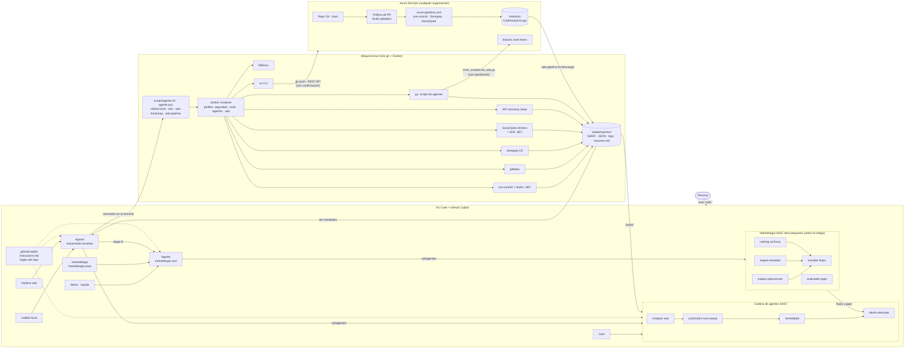
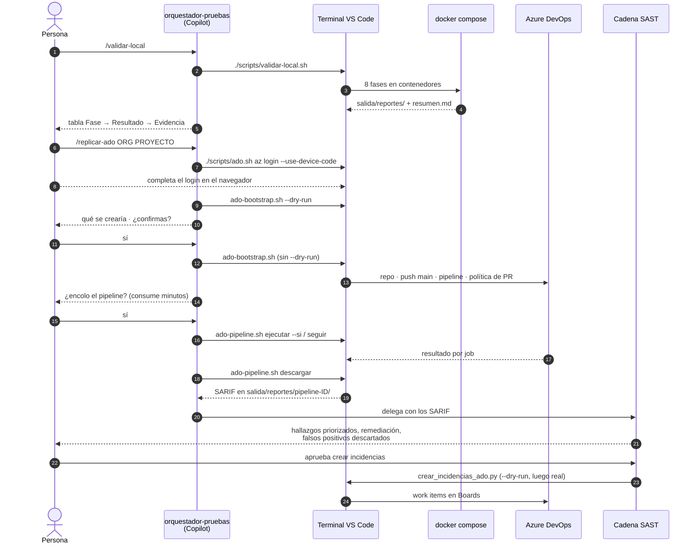
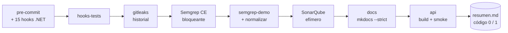
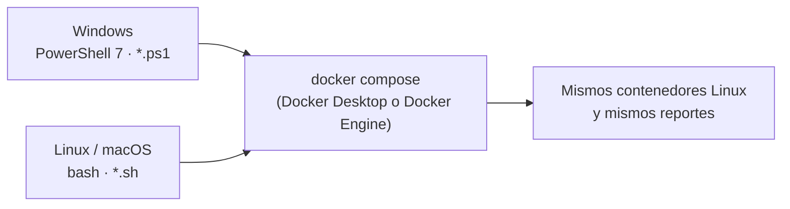

# Arquitectura: ejecución desde VS Code

Cómo funciona el flujo cuando se ejecuta desde **VS Code con GitHub Copilot**: qué
piezas intervienen, dónde corre cada una y qué datos pasan entre ellas.

La regla de fondo: **en la máquina solo hacen falta git, Docker y VS Code con Copilot.**
Copilot no ejecuta herramientas de seguridad por sí mismo; lanza los scripts del repo
en la terminal de VS Code, y estos levantan contenedores con `docker compose`.

## Vista general

## Componentes

| Capa | Pieza | Dónde vive | Qué hace |
|---|---|---|---|
| Interfaz | VS Code + GitHub Copilot (modo agente) | Máquina | Chat, selección de agente, aprobación de comandos |
| Reglas | `copilot-instructions.md` | `.github/` | Reglas comunes: solo Docker, sin secretos, Fortify como herramienta oficial, revisión humana |
| Orquestación | `orquestador-pruebas` | `.github/agents/` | Etapas A–D, checklist, confirmaciones antes de acciones externas |
| Skills (comandos `/`) | `/ayuda`, `/demo`, `/metodologia`, `/metodologia-paso`, `/sast`, `/validar-local`, `/replicar-ado` | `.github/skills/<nombre>/SKILL.md` | Arrancan una etapa concreta; sin argumentos usan la muestra vulnerable. Los `.prompt.md` de `.github/prompts/` solo remiten a ellas (compatibilidad) |
| Análisis | `receptor-sast` → `priorizador-cwe-owasp` → `remediador` → `devils-advocate` | `.github/agents/` | Normalizar, clasificar CWE/OWASP, proponer corrección, refutar falsos positivos |
| Metodología | `metodologia-sast` + `ranking-archivos`, `mapeo-entradas`, `mapeo-operaciones`, `trazador-flujos`, `analizador-gaps` | `.github/agents/` | Analiza el **código**: flujos entre capas y gaps contra requisitos; un paso o todos ([detalle](metodologia-sast.md)) |
| Ejecución | `agente` (punto de entrada único), `validar-local`, `ado`, `ado-bootstrap`, `ado-pipeline` (en `.sh` y `.ps1`), `sonar-analizar.sh` | `scripts/` | Envuelven `docker compose`; detectan SO, UID/GID, grupo de Docker y puertos |
| Herramientas | Servicios de `docker-compose.yml` | Contenedores | pre-commit, gitleaks, Semgrep, SonarQube, MkDocs, API, Python, az |
| Reglas propias | Hooks .NET, reglas Semgrep | `tools/pre-commit-hooks/`, `.semgrep/` | Lo que SonarQube Community no cubre ([detalle](hooks-dotnet.md)) |
| Código a analizar | Muestra vulnerable y proyectos del concurso | `agente-sast-g7/samples/app-vulnerable/`, `objetivos/<proyecto>/` (no versionado) | Objetivo de la ejecución real de los agentes; fuera de los gates bloqueantes. SARIF con el servicio `semgrep-objetivo` |
| Resultados | Reportes | `salida/reportes/` (no versionado) | Entrada de la cadena SAST y evidencia para la persona |
| Remoto | Repo, pipeline, política de PR, Boards | Azure DevOps | Los mismos controles en cada PR a `main`; incidencias |

## Flujo de una ejecución completa

## Fases locales (`validar-local.sh`)

Cada fase es un servicio de `docker compose` y deja su log en
`salida/reportes/logs/<fase>.log`. Las mismas versiones (pre-commit 4.7.0, gitleaks
v8.30.1, Semgrep 1.185.0, .NET 10) corren en `azure-pipelines.yml`, así que lo que pasa
en local pasa en el PR.

## Límites de confianza

| Frontera | Control |
|---|---|
| Copilot → terminal | VS Code pide aprobar cada comando (salvo que la persona lo autorice); el agente solo usa los scripts del repo |
| Máquina → Azure DevOps | Siempre `--dry-run` primero y confirmación explícita antes de crear repo, push, pipeline, ejecuciones o work items |
| Credenciales | `az login` con código de dispositivo, sesión en `~/.azure` del host. Un PAT solo en la variable `AZURE_DEVOPS_EXT_PAT`, nunca en archivos, chat ni logs |
| Hallazgos → incidencias | `devils-advocate` refuta antes; la persona aprueba; no se parchea código automáticamente |
| Host | No se instala nada: los contenedores montan el repo y, para SonarQube, el socket de Docker |

## Requisitos para ejecutarlo en VS Code

1. git, Docker con el plugin `docker compose`, y el usuario en el grupo `docker`
   (en Windows: Git for Windows, Docker Desktop con WSL2 y **PowerShell 7**).
2. VS Code con **GitHub Copilot** y **Copilot Chat** en modo agente.
3. Abrir la **raíz del repo** como carpeta del workspace (y confiar en ella): Copilot solo
   carga `.github/agents/` y `.github/skills/` de la raíz.
4. En el chat, escribir `/demo` (o `/ayuda`), o elegir un agente del desplegable de agentes
   (no el de modelo) y escribir `ejecuta`.

### Windows o Linux

Los scripts existen en bash (`.sh`) y PowerShell 7 (`.ps1`) con las mismas fases y
códigos de salida. El agente mira qué terminal tiene VS Code (PowerShell en Windows, bash
en Linux/macOS) y usa la versión que corresponde; la tabla de equivalencias está en
`.github/copilot-instructions.md`. Debajo de los scripts todo es igual: `docker compose`
con contenedores Linux. Para SonarQube, el contenedor que orquesta se une a la red del
servidor efímero y el SDK hereda el montaje del repo (`--volumes-from`), así que no
depende de rutas `C:\...` ni de la red del host.

Para montarlo desde cero en otra máquina y otra organización, ver
[Replicar en otra máquina](replicar.md).
