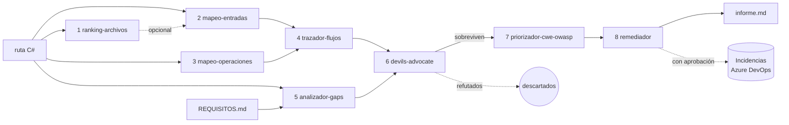

# Metodología SAST descompuesta

Implementación, como agentes de **GitHub Copilot**, del patrón de *razonamiento
descompuesto* de la skill `sast-methodology` de
[pentest-agents](recomendaciones.md#que-reutilizar-de-pentest-agents), adaptado al
Grupo 7: es **defensiva** (no hay paso de prueba de explotación) y termina en
remediación con revisión humana.

En lugar de pedir a un solo agente "encuentra vulnerabilidades", cada paso hace **una**
cosa, deja un JSON y el siguiente parte de él. Las herramientas deterministas (Semgrep,
SonarQube, pre-commit) siguen bloqueando; esto analiza lo que ellas no ven: **flujos de
datos entre archivos** y **controles que faltan según los requisitos**.

Detalle de cada paso (archivos de entrada, proceso, validación, archivos de salida campo
por campo y ejemplos reales): [Metodología SAST en detalle](metodologia-detalle.md)
(`agente-sast-g7/METODOLOGIA.md` en el repo).

## Pasos

| # | Paso | Agente | Corre solo | Necesita | Genera (`salida/reportes/metodologia/`) |
|---|---|---|---|---|---|
| 1 | Ranking de archivos por riesgo | `ranking-archivos` | Sí | ruta | `ranking.json` |
| 2 | Mapeo de entradas externas | `mapeo-entradas` | Sí | ruta (usa 1 si existe) | `entradas.json` |
| 3 | Mapeo de operaciones peligrosas | `mapeo-operaciones` | Sí | ruta | `operaciones.json` |
| 4 | Trazado de flujos entre capas | `trazador-flujos` | No | 2 y 3 | `flujos.json` |
| 5 | Análisis de gaps contra requisitos | `analizador-gaps` | Sí, con requisitos | ruta + requisitos | `gaps.json` |
| 6 | Validación adversarial | `devils-advocate` | No | 4 y/o 5 | `validacion.json` |
| 7 | Priorización CWE/OWASP | `priorizador-cwe-owasp` | No | 6 | `priorizacion.json` |
| 8 | Remediación | `remediador` | No | 7 | `remediacion.json` |
| — | Informe | `metodologia-sast` | No | lo que exista | `informe.md` |



Los pasos 1, 2, 3 y 5 son independientes entre sí. El 4 necesita los JSON de 2 y 3; si
faltan, el orquestador lo dice y ofrece ejecutarlos antes.

## Cómo se usa en VS Code

Abre la **raíz del repo** en VS Code con Copilot Chat en modo agente:

| Quiero… | Escribe |
|---|---|
| La demo completa sobre la muestra, con comparación | `/demo` |
| Ver el menú de pasos y qué ya se generó | agente `metodologia-sast` → `menú` (o `/ayuda`) |
| Ejecutar todos los pasos sobre la muestra | `/metodologia` |
| Ejecutar todos sobre un proyecto real del concurso | `/metodologia objetivos/<proyecto>` (ver [uso en Copilot](uso-copilot.md)) |
| Un paso puntual | `/metodologia-paso 3` o `/metodologia-paso operaciones` |
| Un paso que depende de otros | `/metodologia-paso flujos` → si faltan `entradas.json`/`operaciones.json`, ofrece generarlos |

`/metodologia-paso` entiende número, nombre del agente o alias en lenguaje natural
(`paso 4`, `4`, `trazador`, `flujos`). Los comandos `/` son **skills nativas** de
`.github/skills/` (funcionan en los arneses Copilot y Local); los `.prompt.md` solo remiten a
ellas por compatibilidad.

También se puede elegir directamente el agente de un paso (por ejemplo `trazador-flujos`)
y escribir `ejecuta`: sin más datos trabaja sobre la muestra y, al terminar, sugiere el
paso siguiente.

En la terminal, la parte determinista (candidatos de los pasos 1–3, Semgrep y comparación
con la referencia) es un solo comando: `./scripts/agente.sh demo [ruta]` (PowerShell:
`./scripts/agente.ps1 demo`); `./scripts/agente.sh comparar` compara lo que haya en
`salida/reportes/metodologia/` con `esperado/`.

## Determinista + IA

`agente-sast-g7/scripts/metodologia.py` (Python estándar, en contenedor) genera los
**candidatos** de los pasos 1–3 con heurísticas; el agente los verifica en el código,
descarta ruido y añade lo que el script no ve (por ejemplo propiedades de un DTO o un
servicio que debería aplicar una regla de negocio). El script:

- Analiza por **sentencias**, no por líneas: quita comentarios respetando cadenas y une
  cada sentencia aunque ocupe varias líneas (llamadas encadenadas, argumentos partidos,
  SQL concatenado en varias líneas). Reporta la línea donde empieza la coincidencia.
- Resuelve dentro del archivo la **configuración definida aparte**: un
  `JsonSerializerSettings` con `TypeNameHandling` inseguro en un campo, una variable, una
  asignación posterior o `JsonConvert.DefaultSettings`, y lo une a la llamada
  `DeserializeObject` que lo usa.
- Marca cada operación con **`confianza`**: `alta` si algún argumento sale de un parámetro
  del método o de `Request` (siguiendo variables locales), `media` si no pudo
  determinarlo. Las rutas armadas solo con literales, constantes o rutas internas
  (`AppContext.BaseDirectory`, `ContentRootPath`, `Assembly...`) se descartan; `detalle`
  explica la decisión.

```bash
docker compose --profile agentes run --rm py agente-sast-g7/scripts/metodologia.py todo \
  agente-sast-g7/samples/app-vulnerable --dir salida/reportes/metodologia
```

Los pasos 4–8 son razonamiento del agente: seguir el dato entre archivos, comparar con
los requisitos, refutar e interpretar.

## Muestra y respuesta de referencia

`agente-sast-g7/samples/app-vulnerable/` es una API .NET sintética de un banco ficticio
con fallas **a propósito** para que cada paso encuentre algo: 10 flujos vulnerables (3
cruzan controlador → servicio → repositorio), 1 flujo que parece vulnerable pero está
saneado (para que `devils-advocate` lo refute) y 10 gaps contra su `REQUISITOS.md`. El
inventario completo está en `agente-sast-g7/samples/app-vulnerable/README.md`.

En `esperado/` está la ejecución de referencia (un JSON por paso e `informe.md`):

| Paso | Resultado de referencia |
|---|---|
| 1 ranking | 8 archivos de riesgo Alto de 15 |
| 2 entradas | 15 entradas, 11 sin validación |
| 3 operaciones | 15 operaciones peligrosas |
| 4 flujos | 11 flujos (1 saneado) |
| 5 gaps | 10 gaps contra requisitos |
| 6 validación | 20 sobreviven, 1 refutado (F-11) |
| 7 priorización | 20 hallazgos, 16 de prioridad Alta |
| 8 remediación | 20 recomendaciones |

Sirve para evaluar a Copilot: ejecuta `/metodologia` y compara
`salida/reportes/metodologia/` con `esperado/`.

## Pruebas

`agente-sast-g7/scripts/tests/test_metodologia.py` comprueba que, sobre la muestra, el
script encuentra las entradas y operaciones esperadas, que en código limpio no reporta
operaciones, y que la referencia tiene hallazgos en **todos** los pasos y refuta el flujo
saneado. Corre en:

- `./scripts/validar-local.sh --solo metodologia` (en PowerShell: `./scripts/validar-local.ps1 -Solo metodologia`)
- el pipeline (job Semgrep): las pruebas bloquean; los candidatos sobre la muestra se
  publican en el artefacto `CodeAnalysisLogs/metodologia/` sin bloquear.

## Límites

- Los pasos 4–8 dependen del modelo: los resultados pueden variar entre ejecuciones. Por
  eso pasan por `devils-advocate` y **no bloquean** el pipeline.
- El script es heurístico para C#/ASP.NET Core: entiende sentencias y variables dentro de
  **un archivo**, no sigue el dato entre archivos (eso es el paso 4, del agente) ni
  resuelve tipos, herencia o inyección de dependencias. Configuraciones que llegan de
  otro archivo quedan con `confianza: media`.
- No hay paso de explotación (PoC): el reto del Grupo 7 es defensivo.
