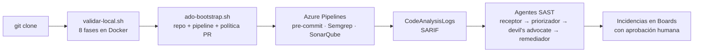

# Replicar en otra máquina y otro Azure DevOps

Guía de cero: clonar el repo en una máquina nueva, ejecutar todas las fases de prueba en
local, subirlo a **otra** organización de Azure DevOps y dejar que el agente de Copilot
haga el flujo completo.



## 1. Requisitos

| Herramienta | Para qué | ¿Obligatoria? |
|---|---|---|
| git | Clonar y subir el repo | Sí |
| Docker con el plugin `docker compose` | Todas las fases corren en contenedores | Sí |
| VS Code + GitHub Copilot (modo agente) | Usar el agente `orquestador-pruebas` | Para el agente |
| PowerShell 7 (`pwsh`) | Ejecutar los `.ps1` | Solo en Windows (ver [Windows](#windows)) |
| Azure CLI | Subir a Azure DevOps | **No**: `scripts/ado.sh` / `ado.ps1` lo corre en un contenedor |

No hace falta instalar Python, .NET, Semgrep, pre-commit, gitleaks ni SonarQube: cada uno
corre en su imagen, con la misma versión fijada que el pipeline. Tu usuario debe poder usar
Docker sin `sudo` (grupo `docker`).

La primera ejecución descarga y construye varias imágenes (unos GB: SDK de .NET, SonarQube,
Semgrep con sus reglas, pre-commit con sus hooks); las siguientes no descargan nada. Para una máquina sin internet, ver la
sección 6.

### Windows

Cada script de `scripts/` tiene su versión **PowerShell 7** (`.ps1`) con las mismas fases,
reportes y códigos de salida; los `.ps1` también funcionan en Linux y macOS.

| Herramienta | Notas |
|---|---|
| [Git for Windows](https://git-scm.com/download/win) | El valor de `core.autocrlf` da igual: `.gitattributes` fuerza LF en todos los archivos de texto, así los scripts funcionan dentro de los contenedores Linux |
| [Docker Desktop](https://www.docker.com/products/docker-desktop/) con backend **WSL2** | Debe estar abierto. Contenedores Linux (el modo por defecto) |
| [PowerShell 7](https://learn.microsoft.com/powershell/scripting/install/installing-powershell-on-windows) | `winget install Microsoft.PowerShell`. Windows PowerShell 5.1 **no** sirve |

Si Windows bloquea los scripts descargados (política de ejecución), desbloquéalos una vez
o ejecútalos con `-ExecutionPolicy Bypass`:

```powershell
Get-ChildItem .\scripts\*.ps1 | Unblock-File
# o, por ejecución:
pwsh -ExecutionPolicy Bypass -File .\scripts\validar-local.ps1
```

Equivalencias (las opciones `--x` de `ado-pipeline` son las mismas):

| bash | PowerShell 7 |
|---|---|
| `./scripts/validar-local.sh --saltar sonarqube` | `./scripts/validar-local.ps1 -Saltar sonarqube` |
| `./scripts/validar-local.sh --solo semgrep,api` | `./scripts/validar-local.ps1 -Solo semgrep,api` |
| `./scripts/ado.sh az login --use-device-code` | `./scripts/ado.ps1 az login --use-device-code` |
| `./scripts/ado.sh ./scripts/ado-bootstrap.sh --org … --project … --dry-run` | `./scripts/ado-bootstrap.ps1 -Org … -Project … -DryRun` |
| `./scripts/ado.sh ./scripts/ado-pipeline.sh --org … --project … seguir --pr 30` | `./scripts/ado-pipeline.ps1 --org … --project … seguir --pr 30` |
| `read -rs AZURE_DEVOPS_EXT_PAT && export AZURE_DEVOPS_EXT_PAT` | `$env:AZURE_DEVOPS_EXT_PAT = Read-Host -MaskInput` |

En Docker Desktop, SonarQube lanza sus contenedores como root (el socket de Docker de la VM
solo lo usa root) y el resto con UID 1000; no hay que configurar nada. Clona el repo en una
ruta corta y sin espacios (p. ej. `C:\src\agente_pruebas_copilot`).

## 2. Clonar

```bash
git clone <URL_DEL_REPO> agente_pruebas_copilot
cd agente_pruebas_copilot
cp .env.example .env        # opcional: puertos y UID/GID si no son los de tu usuario
```

Las bases oficiales del hackathon **no** están en git (`docs/datos/…docx`,
`docs/hackapro-bases.md`); cópialas a mano si las necesitas para el sitio de documentación.

## 3. Validar en local

```bash
./scripts/validar-local.sh          # Linux / macOS
```

```powershell
./scripts/validar-local.ps1         # Windows (PowerShell 7); también Linux / macOS
```

Ejecuta en orden, cada una en su contenedor:

| Fase | Qué valida |
|---|---|
| `pre-commit` | Hooks de `.pre-commit-config.yaml`, incluidos gitleaks y los [hooks .NET](hooks-dotnet.md) |
| `hooks-tests` | Pruebas de los hooks .NET propios |
| `gitleaks` | Secretos en todo el historial de git |
| `semgrep` | SAST bloqueante con las reglas del pipeline |
| `semgrep-demo` | Reporte con hallazgos sobre la muestra vulnerable, normalizado para los agentes |
| `metodologia` | Pruebas del script de la [metodología SAST](metodologia-sast.md) y candidatos sobre la app vulnerable |
| `sonarqube` | SonarQube Community efímero sobre `rickmorty-clean` |
| `docs` | Este sitio en modo estricto (`salida/sitio.zip`) |
| `api` | Build de `rickmorty-clean` y prueba de sus 8 endpoints en un puerto libre |

Resultado en `salida/reportes/resumen.md` y logs en `salida/reportes/logs/`. Opciones:
`--saltar sonarqube` (la fase más lenta), `--solo semgrep,api`, `--listar`
(en PowerShell: `-Saltar`, `-Solo`, `-Listar`).

El script detecta lo que depende de la máquina (sistema operativo, tu UID/GID, el grupo
del socket de Docker) y busca un puerto libre para la API, así que no choca con otros
servicios. SonarQube usa el puerto 9100 (`SONAR_PORT` para cambiarlo).

## 4. Subir a otro Azure DevOps

Necesitas una organización y un **proyecto ya creado**, con permisos para crear repos,
pipelines y políticas.

```bash
# Iniciar sesión (abre un código para el navegador). La sesión queda en ~/.azure.
./scripts/ado.sh az login --use-device-code

# Simulacro: solo consulta, muestra qué crearía
./scripts/ado.sh ./scripts/ado-bootstrap.sh --org https://dev.azure.com/MI_ORG --project MI_PROYECTO --dry-run

# De verdad (idempotente: se puede repetir)
./scripts/ado.sh ./scripts/ado-bootstrap.sh --org https://dev.azure.com/MI_ORG --project MI_PROYECTO
```

`ado-bootstrap.sh` crea el repositorio, sube la rama `main` **tal como está commiteada**,
crea el pipeline `<repo>-seguridad` desde `azure-pipelines.yml` y la política *Build
validation* bloqueante sobre `main`. No borra ni modifica nada que ya exista.

En lugar de `az login` puedes usar un PAT, **solo** como variable de entorno de tu
terminal (nunca en un archivo ni en el chat):

```bash
read -rs AZURE_DEVOPS_EXT_PAT && export AZURE_DEVOPS_EXT_PAT
```

!!! warning "Organización nueva sin agentes"
    Las organizaciones nuevas pueden no tener paralelismo hospedado gratuito: el pipeline
    queda en cola sin agente. Se solicita en
    <https://aka.ms/azpipelines-parallelism-request> (tarda unos días).

### Ejecutar, seguir y descargar el pipeline

`scripts/ado-pipeline.sh` usa la API REST con la misma sesión de `az login` (o el PAT del
entorno); no necesita la extensión `az pipelines`.

```bash
AP="./scripts/ado.sh ./scripts/ado-pipeline.sh --org https://dev.azure.com/MI_ORG --project MI_PROYECTO"
$AP ejecutar --rama main --si   # encola (consume minutos; exige --si) e imprime el id
$AP seguir <ID>                 # o: seguir --pr <n> | seguir --rama main
$AP descargar <ID>              # → salida/reportes/pipeline-<ID>/CodeAnalysisLogs/
$AP estado-pr <n>               # estado del PR y su último build
```

`seguir` termina con la tabla *Job → resultado* y sale con 0 (succeeded), 1 (otro
resultado) o 2 (timeout), así que sirve también en scripts.

El pipeline no usa extensiones del Marketplace, *service connections* ni servidores
externos: no hay que configurar nada más en la organización destino. Las variables
`SONAR_HOST_URL` y `SONAR_TOKEN` son opcionales (ver [Pipeline de seguridad](pipeline.md)).

## 5. Usar el agente de Copilot

Abre la **raíz del repo** en VS Code (Copilot solo carga `.github/` de la raíz) y, en el
chat en modo agente, escribe una skill con `/` o elige `orquestador-pruebas` en el
desplegable de agentes y escribe `ejecuta`. El agente detecta si la terminal es PowerShell
o bash y usa los `.ps1` o los `.sh` según corresponda:

| Skill | Qué hace |
|---|---|
| `/ayuda` | Menú con todos los comandos (chat y terminal) |
| `/demo` | Metodología SAST completa sobre la app vulnerable y comparación con la referencia |
| `/validar-local` | Etapa A: corre `validar-local.sh`, lee los reportes y explica cada falla |
| `/replicar-ado https://dev.azure.com/ORG PROYECTO` | Etapas A → C: chequeo rápido, simulacro, réplica, ejecuta el pipeline y descarga `CodeAnalysisLogs` |
| `/sast salida/reportes/semgrep-muestras.sarif` | Etapa D: cadena receptor → priorizador → remediador → devil's advocate → incidencias |

En la terminal, los mismos atajos: `./scripts/agente.sh demo`, `rapido`, `ado-login`,
`replicar <org> <proyecto> [--real]`, `pipeline seguir --pr <n>` (PowerShell:
`./scripts/agente.ps1 ...`). Guía completa: [Uso con Copilot](uso-copilot.md).

El agente **pide confirmación antes de cada acción externa** (crear repo, push, pipeline,
ejecución, work items), nunca pide el PAT en el chat y no instala nada en la máquina.

## 6. Máquina sin internet

Todo lo que las fases bajaban al ejecutarse (reglas de Semgrep, hooks de pre-commit,
`dotnet-sonarscanner`, paquetes NuGet) está **dentro de las imágenes** de `tools/`. Se
construyen una vez en una máquina con internet y se llevan a la otra en un archivo:

```bash
# Máquina con internet (PowerShell: ./scripts/imagenes.ps1 exportar)
./scripts/imagenes.sh exportar        # construye, descarga y guarda imagenes-sast.tar

# Máquina sin internet: copiar el repo y imagenes-sast.tar, y
./scripts/imagenes.sh cargar          # docker load + verificación de las 10 imágenes
./scripts/agente.sh demo              # ya no se descarga nada
SIN_INTERNET=1 ./scripts/validar-local.sh
```

Guía paso a paso, lista de imágenes y límites: `exportar-imagenes-offline.md` en la raíz
del repo.
